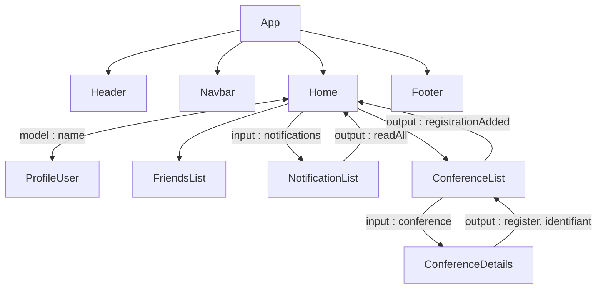

# Comprendre Conference App

Ce guide explique les deux Prosits réalisés dans le projet DAS13. L’application permet de consulter les conférences, d’en afficher les détails et de simuler des inscriptions. Elle est organisée en composants indépendants pour que chaque partie ait un rôle clair.

## 1. Ce que vous pouvez montrer au professeur

La page présente un en-tête, une navigation, un profil, une liste d’amis, des notifications, un agenda de conférences, un panneau de détails et un pied de page. Les exemples reprennent les trois conférences des maquettes : Angular 21 Conference, Signals Workshop et Web Conference.

| Action                                                      | Résultat observable                                                                          |
| ----------------------------------------------------------- | -------------------------------------------------------------------------------------------- |
| Saisir une partie du titre dans la recherche                | La liste se filtre immédiatement, sans tenir compte de la casse ou des accents.              |
| Activer « Places disponibles »                              | Les conférences complètes sont masquées.                                                     |
| Sélectionner une conférence                                 | Son programme apparaît dans le détail, sous la liste.                                        |
| Cliquer sur « S’inscrire » dans une carte ou dans le détail | Le nombre de participants augmente de un, les places diminuent et une notification apparaît. |
| Atteindre la capacité maximale                              | Le bouton devient rouge et désactivé. Les clics suivants ne dépassent jamais la capacité.    |
| Modifier puis enregistrer le nom du profil                  | Le nouveau nom remonte au parent et actualise le message de bienvenue.                       |
| Marquer les notifications comme lues                        | Le compteur des notifications non lues se met à jour.                                        |
| Rechercher un titre inexistant                              | Un message explique qu’aucun résultat ne correspond et permet d’effacer les filtres.         |

Les inscriptions et le profil sont des données de démonstration en mémoire : recharger la page rétablit les valeurs initiales. Aucun compte, paiement ou serveur de réservation n’est nécessaire pour ce travail.

Les événements passés sont retirés de l’agenda au changement de jour, même si l’onglet reste ouvert. Le temporisateur est nettoyé lorsque le composant est détruit.

## 2. Organisation des composants

```text
src/app/
  app.ts / app.html                    Assemblage de la page
  core/
    header/                           En-tête
    navbar/                           Navigation par ancres
    home/                             État partagé du profil et des notifications
    footer/                           Pied de page
  features/
    profile-user/                     Profil modifiable
    friends-list/                     Contacts
    notification-list/                Notifications et compteur
    conferences/
      conference-list/                Données, recherche, sélection, inscriptions
      conference-details/             Détail de la sélection reçue du parent
  shared/
    models/                           Interfaces TypeScript
    icon/                             Icônes SVG locales réutilisables
```

`App` assemble les grandes zones. `Home` compose les panneaux personnels et la liste de conférences. `ConferenceList` possède les données des conférences, conformément au sujet. `ConferenceDetails` reçoit uniquement la conférence à afficher : il ne possède pas une copie indépendante de la liste.



La séparation facilite la maintenance : modifier le pied de page ne demande pas de toucher à la logique d’inscription. Les composants de profil, d’amis et de notifications peuvent également être réutilisés sur une autre page.

## 3. L’interface Conference

Dans `shared/models/conference.ts`, l’interface décrit la forme d’une conférence :

```ts
export interface Conference {
  id: number;
  title: string;
  description: string;
  date: string;
  place: string;
  maxParticipants: number;
  nbParticipants: number;
}
```

Une interface est un contrat de types, pas un objet créé à l’exécution. Elle aide TypeScript à signaler un champ manquant ou une valeur du mauvais type. `id` identifie chaque conférence. Les places restantes correspondent à `maxParticipants - nbParticipants`.

## 4. Les Signals

Un Signal stocke une valeur dont Angular suit les changements :

```ts
readonly searchTerm = signal('');
readonly selectedId = signal<number | null>(null);
```

- `searchTerm()` lit la valeur.
- `searchTerm.set('signals')` remplace la valeur.
- `conferences.update(items => ...)` calcule un nouvel état à partir de l’ancien.

Le mot-clé `readonly` empêche de remplacer la référence du Signal. Il n’interdit pas ses méthodes `set()` et `update()`.

`computed()` est un complément au cours fourni. Il produit une valeur à partir d’autres Signals et la recalcule lorsque ses dépendances changent. Le projet l’utilise pour les résultats filtrés, le compteur des notifications, les places restantes et la conférence sélectionnée.

```ts
readonly selectedConference = computed(() =>
  this.conferences().find(item => item.id === this.selectedId()) ?? null
);
```

Pourquoi conserver un identifiant sélectionné ? Une inscription remplace l’objet conférence par un nouvel objet. Le calcul ci-dessus retrouve sa version actuelle dans la liste. Le détail n’affiche donc jamais un ancien nombre de participants.

## 5. Le data-binding

Le projet montre les quatre formes du cours :

| Forme            | Exemple réel                                     | Rôle                                                     |
| ---------------- | ------------------------------------------------ | -------------------------------------------------------- |
| Interpolation    | `{{ remainingPlaces(conference) }}`              | Afficher une valeur.                                     |
| Property binding | `[disabled]="remainingPlaces(conference) === 0"` | Mettre à jour une propriété du bouton.                   |
| Event binding    | `(click)="selectConference(conference.id)"`      | Réagir à un événement.                                   |
| Two-way binding  | `[(ngModel)]="searchTerm"`                       | Synchroniser la saisie et son Signal dans les deux sens. |

`FormsModule` est importé dans les composants qui utilisent `ngModel`. La recherche normalise le texte avant la comparaison : elle retire les espaces inutiles, les accents et les différences entre majuscules et minuscules. Une recherche « ANGULAR » retrouve donc « Angular 21 Conference ».

## 6. Contrôle de flux et présentation

`@for (conference of visibleConferences(); track conference.id)` affiche chaque conférence. `track` permet à Angular d’identifier les éléments de manière stable au cours des mises à jour.

`@empty` traite l’absence de résultats. L’application distingue deux cas : aucun événement à venir et aucun événement correspondant aux filtres. `@if` et `@else` affichent également l’état vide du détail, le formulaire de profil et les notifications.

Les bindings de classes remplacent les directives de style historiques :

```html
[class.button-success]="remainingPlaces(conference) >= 10"
[class.button-warning]="remainingPlaces(conference) > 0 && remainingPlaces(conference) < 10"
[class.button-danger]="remainingPlaces(conference) === 0"
```

| Places restantes | Couleur | Inscription |
| ---------------- | ------- | ----------- |
| 10 ou plus       | Vert    | Autorisée   |
| De 1 à 9         | Orange  | Autorisée   |
| 0                | Rouge   | Désactivée  |

Les textes « Disponible », « Dernières places » et « Complet » complètent la couleur pour que l’information reste compréhensible sans dépendre de la vision des couleurs.

## 7. Les pipes

Les titres utilisent `UpperCasePipe` : `{{ conference.title | uppercase }}`. Seul l’affichage est transformé ; le titre stocké dans les données reste intact.

Les dates utilisent `DatePipe`. La liste affiche une date compacte et le détail affiche une date complète en français. `app.config.ts` enregistre la locale française et fournit `LOCALE_ID`. Chaque composant standalone importe explicitement les pipes qu’il emploie.

## 8. Communication parent vers enfant avec input

Dans `ConferenceDetails` :

```ts
readonly conference = input<Conference | null>(null);
```

Dans le template du parent :

```html
<app-conference-details
  [conference]="selectedConference()"
  (register)="registerForConference($event)"
/>
```

Lorsque l’utilisateur sélectionne une carte, le parent change `selectedId`. `selectedConference()` est recalculé, puis sa valeur arrive dans l’input de l’enfant. L’affichage du détail suit automatiquement. `null` représente le cas où aucune conférence n’a encore été choisie.

## 9. Communication enfant vers parent avec output

Dans le détail :

```ts
readonly register = output<number>();
// Après vérification de la disponibilité :
this.register.emit(selected.id);
```

L’enfant demande une inscription en émettant un identifiant. Le parent reçoit cet identifiant dans `$event`, vérifie la capacité et met à jour la liste. L’enfant ne modifie jamais directement son input.

L’inscription remplace uniquement la conférence concernée :

```ts
const updated = { ...conference, nbParticipants: conference.nbParticipants + 1 };
this.conferences.update((items) => items.map((item) => (item.id === id ? updated : item)));
```

Cette mise à jour conserve les autres conférences et fournit une nouvelle référence. Une garde TypeScript bloque les événements inconnus, passés ou complets, même si la méthode est appelée autrement que par le bouton. La désactivation visuelle du bouton constitue une protection supplémentaire.

## 10. Communication entre composants voisins

`ConferenceList` et `NotificationList` sont deux enfants de `Home`. Ils communiquent par leur parent :

1. La liste émet `registrationAdded` après une inscription valide.
2. `Home.onRegistration()` ajoute une notification à son Signal.
3. `[notifications]` transmet la nouvelle liste au composant de notifications.
4. Son compteur des éléments non lus est recalculé.

Ce choix convient ici parce que les composants partagent un parent proche. Pour un état partagé entre plusieurs pages éloignées, un service injectable pourrait être plus adapté. Le projet n’ajoute pas de service global dont il n’a pas besoin.

## 11. Communication bidirectionnelle avec model

Le profil expose `name = model<string>('Koussay Laifi')`. Le parent utilise :

```html
<app-profile-user [(name)]="profileName" />
```

`model()` associe une entrée à une sortie de changement. Après validation, `name.set(...)` transmet donc le nom au parent. Le message de bienvenue se met à jour. Une valeur provisoire distincte permet d’annuler la modification sans changer le profil. Un nom vide ou trop court ne peut pas être enregistré.

## 12. Présentation et accessibilité

La palette reprend le bleu des maquettes. Les panneaux du profil, des amis et des notifications conservent leur rôle et leurs accents colorés. Les cartes de conférences indiquent la date, le lieu, la capacité et l’état des inscriptions. Le détail reste sous la liste comme demandé.

Les grilles s’adaptent à la largeur disponible. Les boutons ont des libellés accessibles, les champs ont des labels, la sélection expose `aria-pressed`, les confirmations utilisent une zone d’annonce, les icônes décoratives sont masquées aux lecteurs d’écran et un lien permet d’aller directement au contenu. Les animations respectent la préférence de réduction des mouvements.

Les icônes SVG sont locales. L’application ne dépend pas d’un chargement d’images ou d’une police distante.

## 13. Lancer et vérifier le projet

```bash
npm ci
npm start
```

Ouvrir `http://localhost:4200`. Pour compiler et lancer les tests :

```bash
npm run build
npm test -- --watch=false
```

Les tests vérifient les comportements : recherche réelle depuis le champ, sélection, communication liste/détail, frontières des couleurs, impossibilité de dépasser la capacité, notifications et validation du profil. Ils remplacent aussi le test de démonstration qui attendait l’ancien titre « Hello, DAS13 ».

Le projet existant utilise Angular 22. Les sujets citent Angular 21 ; les API standalone, Signals, `input`, `output`, `model`, `@if` et `@for` employées ici sont compatibles avec cette approche. Le projet n’a pas été rétrogradé.

## 14. Démonstration en cinq minutes

1. Présenter les composants visuels et expliquer leur indépendance.
2. Montrer les 25, 6 et 0 places des exemples, avec les trois couleurs.
3. Rechercher « sig », puis sélectionner Signals Workshop.
4. S’inscrire depuis le détail : la carte et le détail passent de 6 à 5 places, et une notification apparaît.
5. Continuer jusqu’à zéro pour montrer la garde de capacité et le bouton désactivé.
6. Effacer la recherche, puis saisir un titre inexistant pour montrer le message vide.
7. Modifier le nom du profil pour démontrer `model()` et le message de bienvenue.
8. Marquer les notifications comme lues et terminer par le schéma de communication.

Pour expliquer l’essentiel à l’oral : « La liste possède les conférences. Elle transmet la sélection au détail avec un input. Le détail remonte une demande d’inscription avec un output. La liste vérifie la capacité, actualise son Signal et prévient le parent, qui ajoute une notification. »
